# NeuroFlyer

A neural-net playground where populations of ships learn to fly, dodge, shoot and coordinate — through neuroevolution, not backprop. Written from scratch in C++20 with a custom neural network library, a custom evolution library, and an SDL2 + Dear ImGui front end.

<p align="center">
  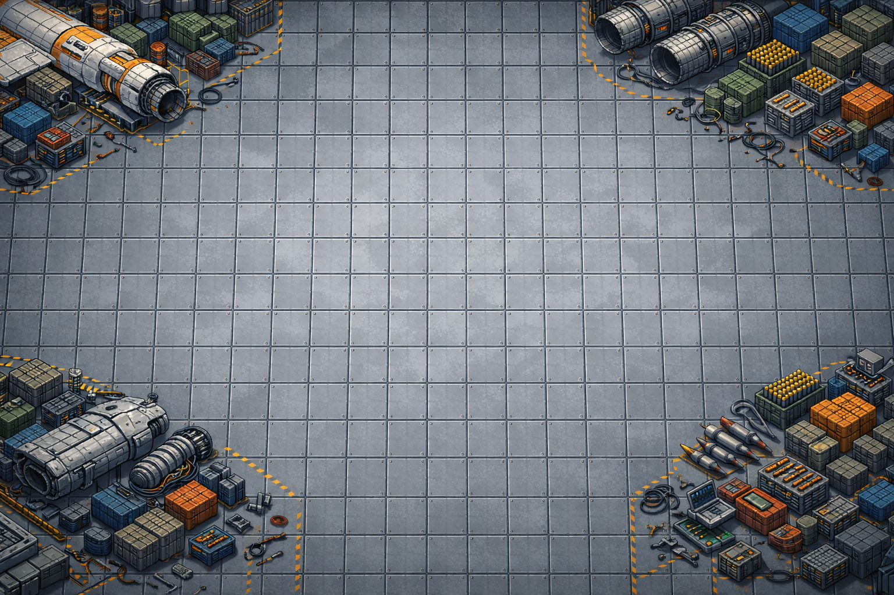
</p>

<p align="center">
  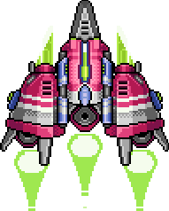
  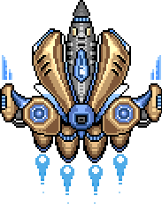
  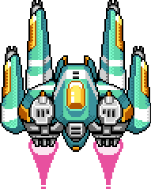
  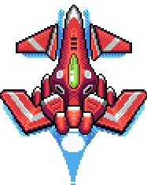
  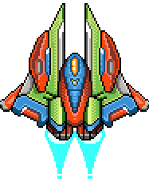
  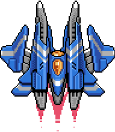
  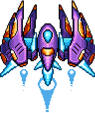
  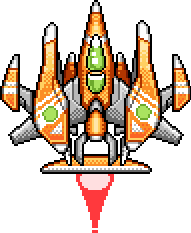
  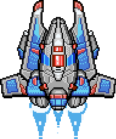
  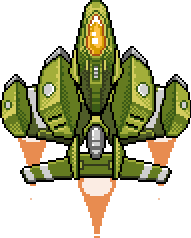
</p>

---

## What it does

NeuroFlyer is both a game and a tool for exploring evolved neural controllers. Every ship on screen is driven by its own feed-forward network with recurrent memory. Populations of 100+ nets compete each generation; survivors mutate (weights **and** topology), crossover, and start the next run. A real-time viewer draws every node, weight and activation so you can watch the brain think.

Two main game surfaces:

- **Vertical-scrolling arcade** — 100 ships learn to dodge towers, collect tokens, and shoot. The scoring function is tunable live; you can watch a population go from "wall huggers" to "tower snipers" in a few hundred generations.
- **Top-down team arena** — teams of ships battle for territory using a **hierarchical brain**: an NTM (Near-Threat Matrix) sub-net scores nearby enemies, a squad-leader net issues tactical orders from macro state, and per-ship fighter nets handle sensorimotor control. All three co-evolve.

Supporting modes include isolated fighter drills (expand / contract / attack phases), attack runs against starbases, squad-vs-squad elimination tournaments, and a full co-evolution mode where multiple teams evolve independent populations against one another.

A **Hangar** screen stores every evolved variant on disk with cross-genome lineage trees, so you can promote a good run into a seed for the next experiment.

---

## Technical highlights

**Custom neural network library** — forward pass, recurrent memory, per-node activation functions (tanh, ReLU, sigmoid, linear), and a mutation-friendly weight layout. Lives in a sibling repo and is reused by two other simulation projects.

**StructuredGenome neuroevolution** — more than weight mutation. Genomes carry:
- Weight genes (Gaussian noise, 10%/gen)
- Topology genes (add/remove nodes and layers)
- Sensor genes (ray and ellipse "occulus" sensors with evolvable angle, range, and width)
- Per-node activation function genes
- Evolvable flags marking which fields are allowed to mutate

Selection is tournament-based with elitism; crossover is uniform within matching topologies.

**Recurrent memory** — ships evolve their own working memory. Hidden-layer activations feed back as extra inputs on the next tick, so controllers can develop state without stacked frames.

**Hierarchical multi-agent brain** (arena mode) — a spatial-index-backed NTM scores nearby enemies with shared weights and top-1 attention; a squad-leader net emits tactical and spacing orders via argmax over output groups; fighter nets consume rotation-aware sensor readings plus squad orders. Three nets, co-evolved per team, in one feedback loop.

**Live net visualization** — a zoom-and-pan neural-net viewer renders every node, weight, and real-time activation for whichever ship you're following. Switch between fighter and squad-leader brains with a keypress; node tooltips show incoming/outgoing weights on hover.

**Clean engine / UI split** — `src/engine/` is pure logic with zero SDL or ImGui dependencies. `src/ui/` wraps engine calls and does all rendering. The arena physics layer (`ArenaWorld`) is the single source of truth for movement, collisions, and bullet lifecycle; every arena-based game mode composes it rather than duplicating physics.

**4-layer UI framework** — a small in-house framework (`UIScreen` → `UIView` → `UIModal` → `ui::` widgets) with a stack-based screen manager, a modal overlay system, and consistent styled controls. Replaces a legacy enum-based screen switcher.

**Binary snapshot format** — custom self-describing serialization (NFS v1–v7) for genomes, including ship design, topology, weights, parent link, and net type. CRC32-checksummed. Backwards compatible across seven schema revisions.

**Test coverage** — 28 GoogleTest suites covering physics, sensors, evolution, snapshot I/O, drill phases, skirmish scoring, and arena ticks. All engine logic is testable without a renderer.

---

## Game modes

| Mode | What it tests |
|------|---------------|
| Scroller | Core neuroevolution loop — one ship, one brain, score-driven selection |
| Arena | Team-vs-team with hierarchical brains and territory control |
| Fighter Drill | Isolate fighter controller training under scripted squad orders (expand / contract / attack) |
| Attack Runs | Fighter accuracy against starbase targets across randomized positions |
| Squad Skirmish | Elimination tournament evolving squad brains (NTM + leader) with frozen fighters |
| Team Skirmish | Full co-evolution — N teams, each evolving their own fighter and squad populations |

Every mode shares the same core: a sensor engine, a physics world, a neural-net executor, and an evolution pass. Modes differ in scoring, scripted inputs, and end conditions.

---

## Architecture at a glance

```
┌─────────────────────────────────────────────────────────────┐
│   UI Layer (SDL2 + ImGui)                                   │
│   UIManager → Screens → Views → Modals → ui:: widgets       │
└──────────────────────┬──────────────────────────────────────┘
                       │ data + callbacks (no SDL below)
┌──────────────────────▼──────────────────────────────────────┐
│   Engine Layer (pure C++20)                                 │
│   ┌─────────────┐  ┌──────────────┐  ┌──────────────────┐   │
│   │ ArenaWorld  │  │ SensorEngine │  │ GenomeManager    │   │
│   │ (physics)   │  │ (perception) │  │ (lineage, I/O)   │   │
│   └─────────────┘  └──────────────┘  └──────────────────┘   │
│   ┌─────────────┐  ┌──────────────┐  ┌──────────────────┐   │
│   │ Evolution   │  │ SquadLeader  │  │ Snapshot I/O     │   │
│   │ (StructGen) │  │ (NTM + orders)│ │ (NFS v1–v7)      │   │
│   └─────────────┘  └──────────────┘  └──────────────────┘   │
└──────────────────────┬──────────────────────────────────────┘
                       │
┌──────────────────────▼──────────────────────────────────────┐
│   Shared libraries (sibling repos, FetchContent)            │
│   neuralnet · neuralnet-ui · evolve                         │
└─────────────────────────────────────────────────────────────┘
```

Rough size: ~85 headers, ~71 source files, 28 test suites — not counting the three shared library repos.

---

## Build & run

```bash
# Requires the sibling library repos at ../libs/
#   libs/neuralnet, libs/neuralnet-ui, libs/evolve
# CMake pulls them in via FetchContent on configure.

cmake -B build -DCMAKE_BUILD_TYPE=Release
cmake --build build -j
./build/neuroflyer
```

Prerequisites: a C++20 compiler, CMake 3.20+, SDL2.

---

## Related repositories

- **[wldarden/neuralnet](https://github.com/wldarden/neuralnet)** — the from-scratch feed-forward network with recurrent memory and per-node activations. Reused by this project and two others.
- **[wldarden/neuralnet-ui](https://github.com/wldarden/neuralnet-ui)** — the live network visualizer: nodes, weights, activations, zoom/pan, hover inspection.
- **[wldarden/evolve](https://github.com/wldarden/evolve)** — the shared evolution library (tournament selection, elitism, crossover, mutation primitives).

---

## Design notes

Deeper architecture reference lives in [CLAUDE.md](CLAUDE.md) at the repo root — it's the document I keep up to date as the project evolves and is the fastest way to get the full picture. The [docs/](docs/) folder holds backlog, feature audits, and design specs for individual subsystems.
